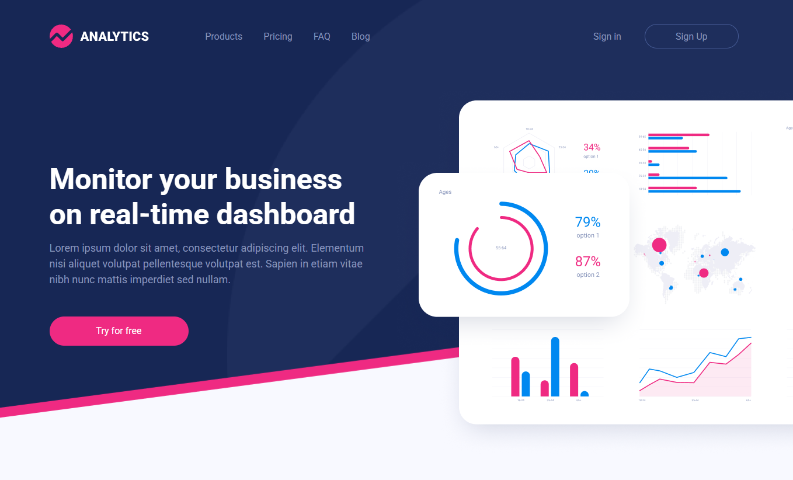

# ANALYTICS

Одностраничный учебный проект (Dec 22, 2022). Демонстрация навыков работы с HTML, CSS.

## О проекте

ANALYTICS — это лендинг-страница. Проект создан в учебных целях для отработки вёрстки по макету, адаптивной сетки.


## Скриншоты

 

## Технологии

- HTML5
- CSS3

## Как запустить локально

1. Клонируй репозиторий:
   ```bash
   git clone https://github.com/Orimous/Dashly-X.git
